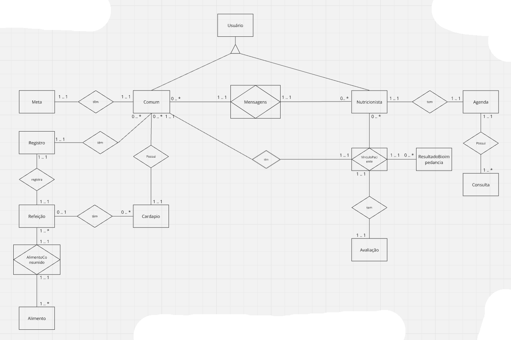
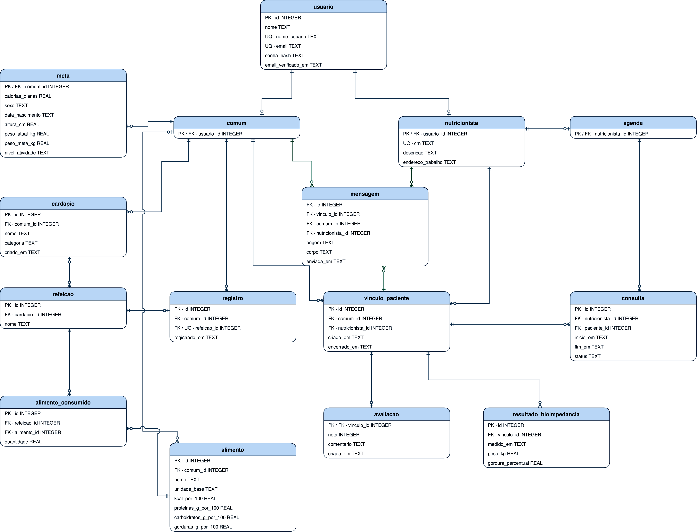

# Dieta Fácil · Projeto e arquitetura de banco de dados

**Projeto Prático de Laboratório de Banco de Dados**

**Equipe** · Alfred Domke Albach, César Augusto Guzmán Fogaça de Almeida, Davi Chwen Shi Guo, Hugo Florio Iorio (líder) e Murilo Ferrari Menezes.

## Contextualização

O Dieta Fácil é um aplicativo de controle alimentar para usuários comuns e nutricionistas. Usuários comuns podem montar cardápios, registrar refeições e buscar acompanhamento profissional. O escopo prevê que nutricionistas gerenciem pacientes, recomendem cardápios, troquem mensagens e organizem consultas.

O projeto prevê PostgreSQL remoto para contas, dados compartilhados e acompanhamento, com SQLite no dispositivo para consultar um catálogo reduzido e montar refeições sem internet. Quando o grupo produziu o documento de contexto, a montagem de cardápios era a funcionalidade implementada, com interface em Kotlin e Compose Multiplatform e três tabelas locais para alimentos, refeições e lançamentos. O trabalho de LBD acrescenta o DER, a modelagem acadêmica e uma implementação PostgreSQL de demonstração. A integração e a sincronização com o aplicativo fazem parte do trabalho futuro.

O SQLite do aplicativo usa valores nutricionais por 1 g ou 1 ml. As bases de demonstração de LBD usam valores por 100 g ou 100 ml. Ao migrar dados do catálogo do aplicativo para LBD, multiplique por 100 os valores nutricionais por unidade. A quantidade do lançamento continua expressa em g ou ml.

Fonte da contextualização · ProjetoLBD.pdf, páginas 1 e 2.

## Modelagem do banco

### MER conceitual

### DER da estrutura base

A imagem do DER apresenta as 15 tabelas base com os tipos SQLite. O [DER PostgreSQL editável](DER_Dieta_Facil_PostgreSQL.drawio) mostra os tipos da entrega acadêmica e inclui a tabela de histórico. A [estrutura PostgreSQL](../postgresql/01_ddl_estrutura.sql) e o [script de programação avançada](../postgresql/03_programacao_avancada.sql) detalham as restrições e a criação do histórico.

## Decisões de modelagem

- O MER não lista atributos. Campos foram detalhados a partir do domínio e dos requisitos publicados do Dieta Fácil.
- Cada cardápio tem um dono. Uma refeição pode pertencer a um cardápio ou ser avulsa. Cada registro aponta para uma refeição exclusiva. Ao carregar um modelo para outro dia, a aplicação deve copiar a refeição e seus itens para registrar uma nova ocorrência.
- A tabela mensagem referencia diretamente o usuário comum e o nutricionista. A FK composta (vinculo_id, comum_id, nutricionista_id) garante que ambos são os participantes do vínculo informado. A origem indica qual participante enviou a mensagem. O par pode ter um vínculo persistente com data de encerramento. Cada vínculo admite uma avaliação e várias medições.
- Meta e agenda usam chave primária compartilhada. O SQL assegura no máximo uma meta por usuário comum e uma agenda por nutricionista. A existência da agenda e a exclusividade entre perfis dependem do fluxo de criação. Um registro definitivo deve ter ao menos um item. O PostgreSQL valida essa regra ao final da transação.
- As procedures validam propriedade da refeição e acesso a alimentos privados nos fluxos do diário. O backend identifica o usuário pela sessão autenticada. A aplicação ainda precisa validar vínculo ativo e sobreposição de consultas. Editar um alimento pode alterar totais calculados de registros anteriores, pois a carga usa referências ao catálogo.
- No PostgreSQL, instantes usam TIMESTAMPTZ e datas civis usam DATE. No SQLite, instantes são TEXT no formato UTC AAAA-MM-DD HH:MM:SS. A aplicação deve normalizar entradas para que ordenação e comparação textual sejam cronológicas. A collation NOCASE do SQLite ignora caixa apenas para ASCII.

## Normalização até a 3FN

- **1FN**. Cada coluna armazena um valor escalar. Refeições, alimentos consumidos, mensagens, avaliações e medições ocupam linhas próprias.
- **2FN**. Em alimento_consumido, cada lançamento tem seu próprio ID. A mesma refeição pode ter várias entradas para o mesmo alimento, cada uma com sua quantidade. As PKs das tabelas PostgreSQL são de uma coluna. O par comum–nutricionista também identifica unicamente um vínculo.
- **3FN**. Os dados da conta ficam em usuário, o CRN no perfil profissional e os nutrientes no catálogo. Os itens não copiam nutrientes nem a unidade. Mensagem é a exceção deliberada à 3FN: repete os IDs dos participantes para buscar por usuário ou nutricionista diretamente, com índice por participante e data. A FK composta impede divergência com o vínculo. O registro guarda seu próprio usuário para comportar refeições avulsas. A consulta referencia uma agenda e um vínculo coerente com o par paciente–profissional. O histórico usa instantâneos JSONB para preservar o conteúdo de cada evento, incluindo os lançamentos que podem ser removidos depois.

## Ações referenciais

- ON UPDATE RESTRICT preserva os identificadores referenciados. ON DELETE CASCADE remove perfis, meta, agenda ou itens de refeição quando são dependências diretas e as outras referências permitem a exclusão.
- ON DELETE RESTRICT protege referências históricas e compartilhadas de registros, consultas, vínculos, avaliações, medições, mensagens, cardápios e alimentos.

## Justificativa dos recursos avançados

| Recurso | Responsabilidade e justificativa |
| --- | --- |
| Procedures de registro, alteração e exclusão | Agrupam escritas do diário, verificam o acesso conforme o fluxo e devolvem o ID do registro. Um erro desfaz as alterações da chamada. A edição registra um evento por alteração efetiva. |
| Função de calorias por lançamento | Aplica a mesma proporção em consultas e relatórios, preservando precisão antes da soma. A view PostgreSQL reutiliza a função. |
| Função de meta calórica | Centraliza a fórmula revisada de Harris-Benedict nas consultas PostgreSQL. O cálculo existente em Kotlin permite uso offline. |
| View de consumo diário | Agrega cinco tabelas por usuário e dia UTC. O HAVING mantém dias com pelo menos um lançamento. Os totais são comparados com a meta vigente. |
| View de agenda | Reúne paciente, nutricionista, horários e status. O backend aplica as permissões conforme a sessão. |
| Gatilho de auditoria de exclusão | Captura o nome, a data e os itens antes que sejam removidos. O evento participa da mesma transação da exclusão. |
| Gatilhos de integridade do diário | Impedem que um registro fique sem alimentos. O PostgreSQL verifica o estado final da transação. O SQLite aplica a regra imediatamente. |

O [guia PostgreSQL](../postgresql/README.md) detalha assinaturas, permissões e exemplos. O [catálogo de erros](../ERROS.md) registra os códigos SQLSTATE `P1001` a `P1013`.

## Índices e evidências

| Índice | Consulta que atende |
| --- | --- |
| `idx_item_refeicao` | Consultar lançamentos de uma refeição. |
| `idx_alimento_nome` | Buscar um nome exato sem distinguir maiúsculas e minúsculas, usando `lower(nome)`. |
| `idx_registro_comum_data` | Ler o diário por usuário e intervalo de datas. |
| `idx_mensagem_comum_data` | Consultar mensagens por usuário comum e data. |
| `idx_mensagem_nutricionista_data` | Consultar mensagens por nutricionista e data. |
| `idx_mensagem_vinculo_data` | Consultar uma conversa por vínculo e data. |

O [script 04](../postgresql/04_testes_e_transacoes.sql) executa as seis consultas com `EXPLAIN (ANALYZE, BUFFERS)`. Na [execução registrada em PostgreSQL 18.7 para Windows](../postgresql/evidencias-postgresql-18.7.txt), os seis índices apareceram nos planos. Em uma repetição com a carga pequena no Docker, o PostgreSQL escolheu uma varredura sequencial para a consulta de itens. A decisão depende das estatísticas e do custo estimado.

## Testes transacionais e execução

1. **Último alimento.** O gatilho devolve `P1013` quando a remoção deixaria uma refeição registrada vazia. O teste verifica que o item foi restaurado e que uma edição válida pode manter duas porções separadas.
2. **Exclusão e auditoria.** Uma tentativa de acesso por outro usuário devolve `P1001`. Depois de uma exclusão válida, uma falha simulada restaura o diário e os itens e desfaz o evento de auditoria.

Os scripts 01 a 04 foram executados no PostgreSQL 18.7 nativo e no Docker. A carga fictícia do PostgreSQL contém 40 usuários, 20 registros e 60 lançamentos. O [README da entrega](../README.md) orienta a execução em SQLite, PostgreSQL e Docker. O [roteiro para o vídeo](../postgresql/roteiro_video.sql) demonstra um exemplo de cada recurso.

[Requisitos funcionais publicados](https://github.com/Organizacao-Dieta-Facil/Dieta_Facil/blob/d04fc50/docs/requisitos/Requisitos%20Funcionais.md)
